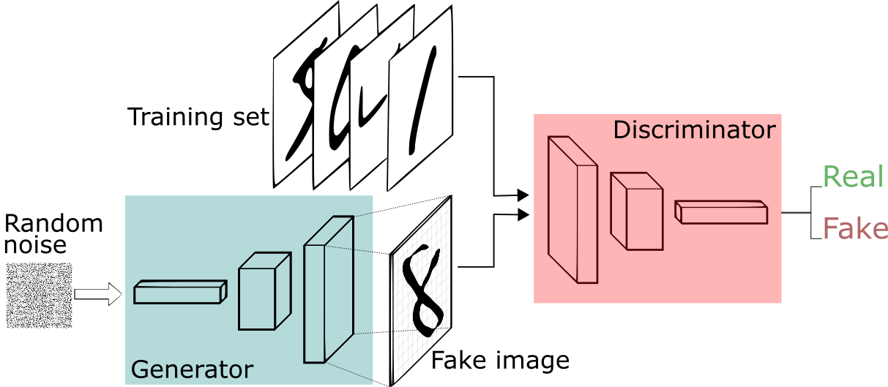

# Generative-Adversarial-Networks-GANs

This is a simple implementation of **Deep Convolutional Generative Adversarial Network using PyTorch** to generate handwritten digits with a generator that learns to generate images that look real and a discriminator that learns to tell real images apart from fakes from the famous MNIST dataset.

